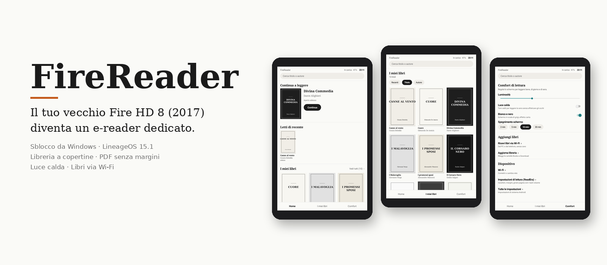
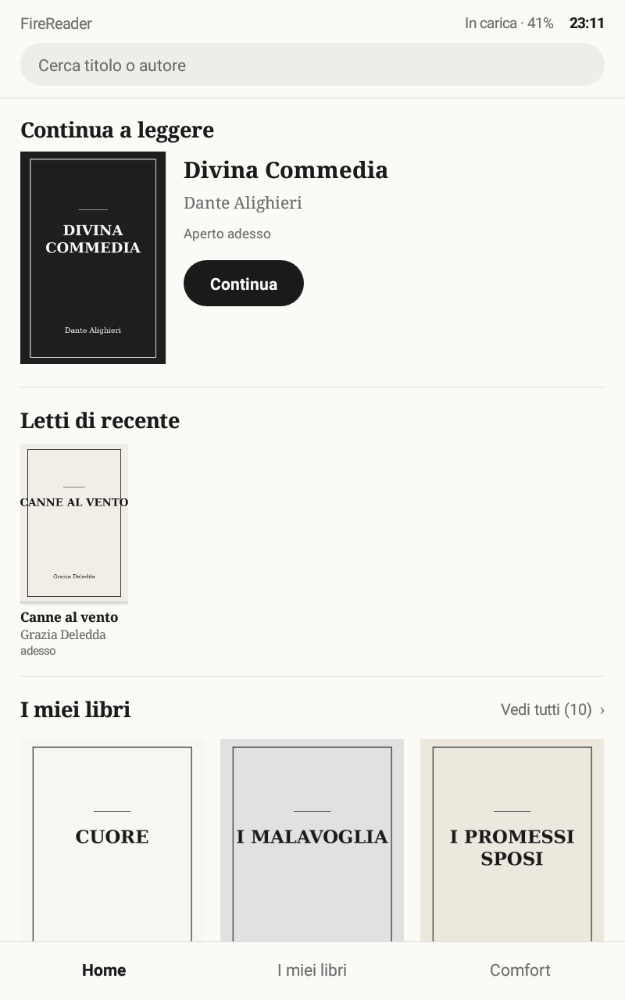
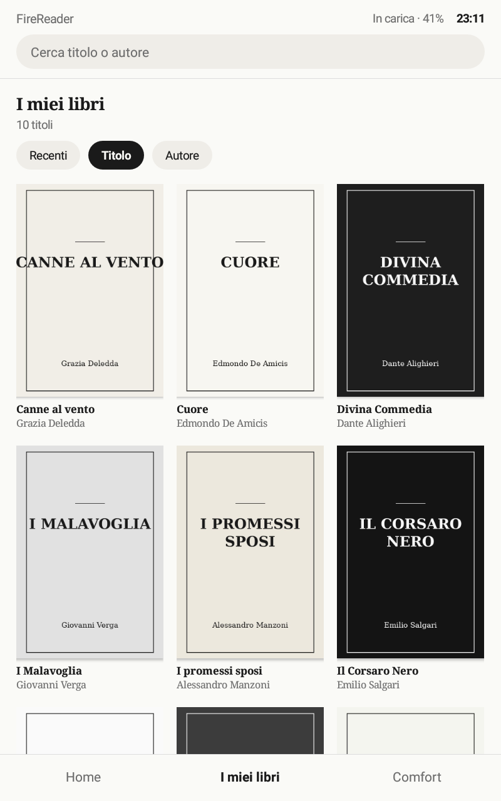
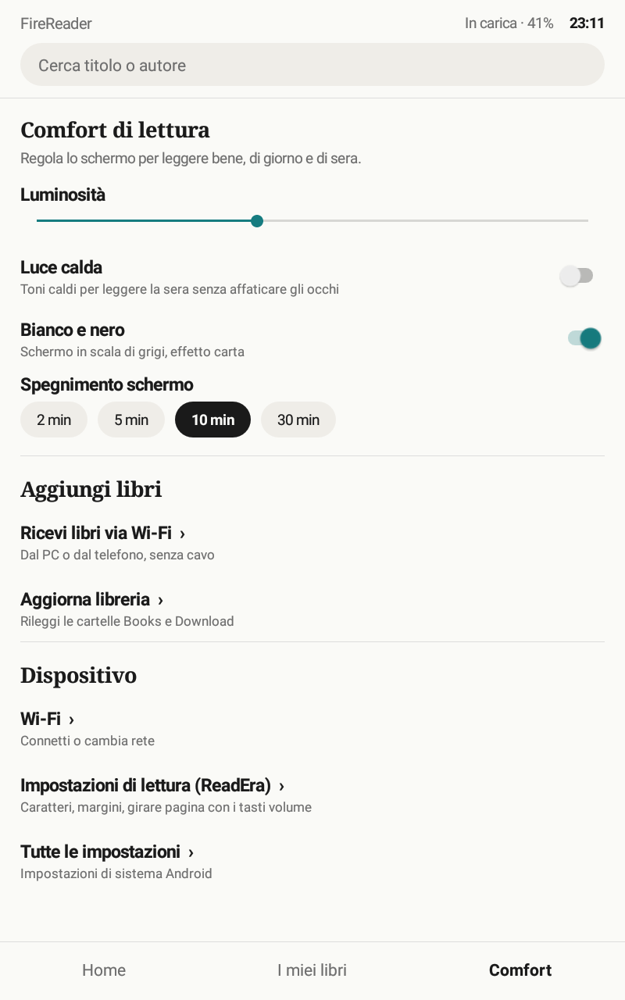
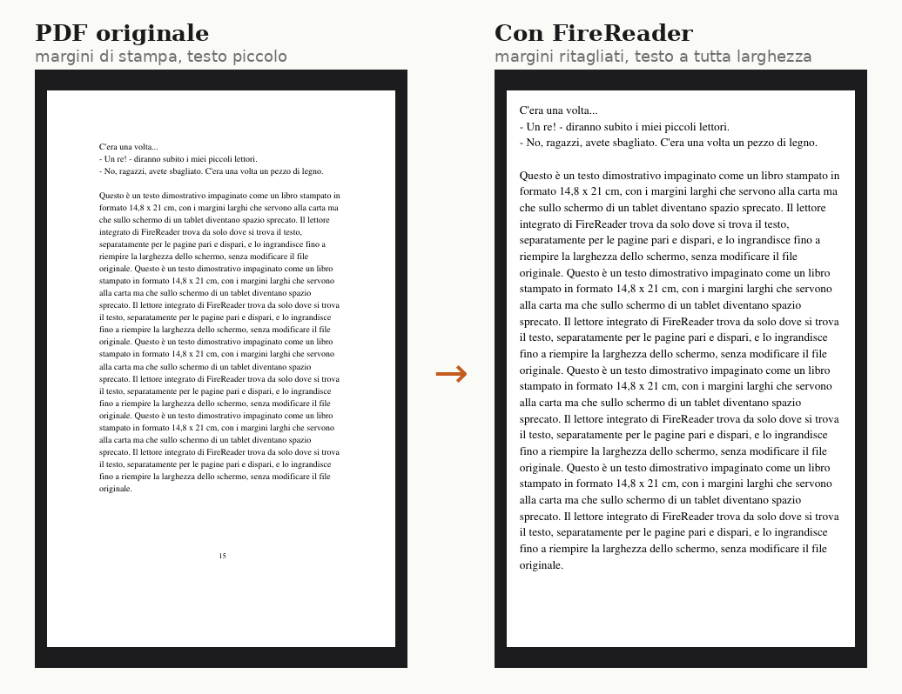
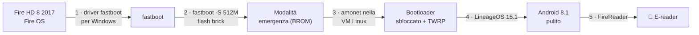

<div align="center">



# FireReader

**Il tuo vecchio Amazon Fire HD 8 (2017) diventa un e-reader dedicato.**
Sblocco interamente da **Windows**, LineageOS al posto di Fire OS e una home pensata solo per leggere.

[](LICENSE)
[](https://github.com/HokutoNoCode/FireReader/releases/latest)
[](app)
[-ff9900?style=flat-square)](docs/GUIDA.md)
[](https://github.com/HokutoNoCode/FireReader/releases/latest)
[](CONTRIBUTING.md)

[**Guida completa**](docs/GUIDA.md) ·
[**Come funziona il codice**](docs/ARCHITETTURA.md) ·
[**Scarica l'APK**](https://github.com/HokutoNoCode/FireReader/raw/main/release/FireReader-3.1.0.apk) ·
[**Contribuire**](CONTRIBUTING.md) ·
[🇬🇧 English](README.md)

</div>

---

## Indice

- [Perché FireReader](#perché-firereader)
- [Funzioni](#funzioni)
- [Screenshot](#screenshot)
- [Come si arriva al risultato](#come-si-arriva-al-risultato)
- [Avvio rapido](#avvio-rapido)
- [Cosa c'è nel repository](#cosa-cè-nel-repository)
- [Domande frequenti](#domande-frequenti)
- [Roadmap](#roadmap)
- [Contribuire](#contribuire)
- [Avvertenze](#avvertenze)
- [Crediti](#crediti)
- [Licenza](#licenza)

## Perché FireReader

Milioni di Fire HD 8 stanno chiusi in un cassetto: Fire OS è lento, pieno di pubblicità e non riceve più
aggiornamenti utili. Come **lettore di libri** però quel tablet è ancora ottimo: schermo da 8", batteria
che dura, tasti del volume per girare pagina.

Il problema è che le guide per sbloccarlo sono pensate per **Linux** e, da Windows, ci si blocca in tre punti.
FireReader raccoglie la procedura completa **testata da Windows** e aggiunge un'app che trasforma il
tablet in qualcosa che somiglia a un Kobo o a un Kindle, ma è tuo e aperto.

## Funzioni

| | |
|---|---|
| 📚 **Libreria a copertine** | Copertine vere estratte da PDF, EPUB e CBZ. Ricerca per titolo o autore, ordinamento per recenti, titolo o autore |
| 📖 **Continua a leggere** | Il libro in corso in primo piano, con **pagina e percentuale reali**, più la riga dei letti di recente |
| ✂️ **PDF senza margini** | Lettore PDF integrato che **ritaglia da solo i margini di stampa** (pagine pari e dispari separate) e porta il testo a tutta larghezza. Il file non viene mai modificato |
| 🔊 **Girare pagina** | Tocco a destra o a sinistra, scorrimento, oppure **tasti del volume** |
| 🌙 **Comfort di lettura** | Luminosità, **luce calda** regolabile per la sera, **bianco e nero** stile carta, spegnimento schermo |
| 📶 **Libri via Wi-Fi** | Dal PC o dal telefono apri `http://<ip-del-tablet>:8080` e trascini i file: niente cavo, niente app |
| 💡 **Schermo intelligente** | Resta acceso mentre leggi, si spegne da solo dopo 15 minuti senza girare pagina |
| 🪶 **Leggerissima** | Circa 40 KB, Java puro, nessuna libreria esterna, nessuna pubblicità né connessione a server esterni |

## Screenshot

<div align="center">
&nbsp;
&nbsp;

<br><sub><b>Home</b> · <b>I miei libri</b> · <b>Comfort</b> (libreria di prova con classici di pubblico dominio)</sub>
<br><br>

<br><sub>Il lettore PDF integrato toglie i margini pensati per la stampa e usa tutto lo schermo.</sub>
</div>

## Come si arriva al risultato



| Passo | Problema da Windows | Soluzione in questo repo |
|:---:|---|---|
| 1 | In fastboot il Fire (`USB\VID_1949&PID_0260`) non ha driver: `fastboot` resta su *waiting for any device* | Pacchetto WinUSB firmato in locale → [`windows/driver`](windows/driver) |
| 2 | Il fastboot moderno spezza l'immagine dell'exploit in blocchi "sparse" e l'exploit non parte | `fastboot -S 512M flash brick …` |
| 3 | Lo script `amonet` arriva a *"all good"* ma poi fallisce con `read fail`: la seriale di Windows non dialoga col payload | Piccola VM Ubuntu che si aggancia il tablet via USB da sola → [`vm`](vm) |

Ogni passaggio, con i comandi esatti e cosa deve comparire sullo schermo, è nella
**[guida completa](docs/GUIDA.md)**.

## Avvio rapido

> Hai già un Fire HD 8 2017 con LineageOS? Allora ti bastano questi comandi.
> Se parti da Fire OS, segui prima la **[guida completa](docs/GUIDA.md)**.

```bash
# 1. scarica release/FireReader-3.1.0.apk (oppure compila: cd app && ./build.sh)
adb install FireReader.apk

# 2. concedi i permessi (luminosità, luce calda, bianco e nero, libri)
adb shell pm grant it.firereader.home android.permission.READ_EXTERNAL_STORAGE
adb shell pm grant it.firereader.home android.permission.WRITE_EXTERNAL_STORAGE
adb shell pm grant it.firereader.home android.permission.WRITE_SECURE_SETTINGS
adb shell appops set it.firereader.home WRITE_SETTINGS allow
adb shell appops set it.firereader.home SYSTEM_ALERT_WINDOW allow

# 3. rendila la home del tablet
adb shell cmd package set-home-activity it.firereader.home/.Home
```

Metti i libri nella cartella **`Books`** della memoria interna, oppure usa **Comfort → Ricevi libri via Wi-Fi**.
Per EPUB e altri formati installa anche [ReadEra](https://readera.org) (gratuito).

## Cosa c'è nel repository

```text
FireReader/
├── app/                         L'app FireReader (Java puro, senza Gradle)
│   ├── AndroidManifest.xml      Permessi, home launcher, lettore e servizio luce calda
│   ├── build.sh                 Compila e firma l'APK con i soli build-tools Android
│   └── src/it/firereader/home/
│       ├── Home.java            Home, libreria, ricerca, Comfort, server Wi-Fi
│       ├── Reader.java          Lettore PDF con ritaglio automatico dei margini
│       └── Warm.java            Filtro "luce calda" sopra lo schermo
├── windows/
│   ├── driver/                  Driver fastboot WinUSB per i Fire + script di (dis)installazione
│   └── adb-bridge.bat           Ponte opzionale per eseguire comandi su Windows da uno script
├── vm/                          VM Ubuntu per VirtualBox che aggancia il tablet via USB
├── patches/                     Patch per eseguire amonet senza tastiera
├── docs/
│   ├── GUIDA.md                 Procedura completa passo passo
│   └── ARCHITETTURA.md          Come funziona ogni file, riga per riga dove serve
├── assets/ · screenshots/       Immagini del README
├── CONTRIBUTING.md              Come contribuire
└── CHANGELOG.md                 Storico delle versioni
```

Ogni file è spiegato in dettaglio in **[docs/ARCHITETTURA.md](docs/ARCHITETTURA.md)**.

## Domande frequenti

<details>
<summary><b>Funziona su altri Fire (HD 10, Fire 7, HD 8 2018/2020…)?</b></summary>

Lo **sblocco** descritto qui vale solo per il **Fire HD 8 2017 "douglas" (KFDOWI)**. Non provarlo su altri
modelli. L'**app FireReader** invece gira su qualsiasi Android 5.0+: puoi usarla su un altro tablet già sbloccato
o anche su un tablet Android qualunque.
</details>

<details>
<summary><b>Posso usare l'app Kindle o i libri comprati su Amazon/Kobo?</b></summary>

Per questo modello la ROM più recente è LineageOS 15.1 (Android 8.1). Le versioni attuali delle app Kindle e
Kobo chiedono Android più recenti. FireReader legge i tuoi file **senza DRM** (EPUB, PDF, CBZ, MOBI…).
</details>

<details>
<summary><b>Perché non Android 9 o successivo?</b></summary>

Le ROM con Android 9 e 10 esistono per il Fire HD 8 **2018** ("karnak"), non per il 2017. Lo sviluppo per
"douglas" è fermo a LineageOS 15.1.
</details>

<details>
<summary><b>Lo schermo è diventato tutto nero, l'ho rotto?</b></summary>

Quasi certamente no. Dopo il "brick" intenzionale lo schermo **deve** restare nero (vedi la guida). Su LineageOS,
invece, la schermata di blocco di questa ROM è nera e sembra un tablet spento: la guida spiega come toglierla.
</details>

<details>
<summary><b>Il ritaglio dei margini taglia qualcosa?</b></summary>

No: il lettore unisce sempre il riquadro tipico del libro con il contenuto reale di **ogni** pagina, quindi
titoli, note o immagini più larghe restano visibili. Se un libro rende meglio intero, tocca al centro e scegli
**Margini: originali** (l'impostazione è salvata per quel libro).
</details>

<details>
<summary><b>Mi serve per forza Linux o una VM?</b></summary>

Solo per un passaggio (il passo 3, *bootrom*). Tutto il resto si fa da Windows. La VM viene creata da uno script
e non richiede di installare Linux sul PC.
</details>

## Roadmap

- [ ] Lettore EPUB integrato (impaginazione, caratteri, interlinea) per non dipendere da app esterne
- [ ] Collezioni / scaffali personalizzati
- [ ] Sincronizzazione con [Calibre](https://calibre-ebook.com) (protocollo wireless)
- [ ] Dizionario offline e sottolineature
- [ ] Traduzione dell'interfaccia in inglese
- [ ] Icona dell'app dedicata

Hai un'idea? Apri una [issue](https://github.com/HokutoNoCode/FireReader/issues/new/choose).

## Contribuire

Ogni aiuto è benvenuto: codice, test su altri dispositivi, correzioni alla guida, traduzioni.
Leggi **[CONTRIBUTING.md](CONTRIBUTING.md)**: spiega come compilare, provare sul tablet e proporre modifiche.

## Avvertenze

> [!WARNING]
> - Lo sblocco vale **solo** per il **Fire HD 8 di 7ª generazione (2017), "douglas", KFDOWI**.
> - Sbloccare **cancella tutti i dati** del tablet e invalida la garanzia. Procedi **a tuo rischio**.
> - I file di sblocco (preloader, TrustZone, LK, immagini brick, TWRP) e le ROM **non sono inclusi**:
>   appartengono ai rispettivi autori e ad Amazon. Scaricali dalle fonti originali indicate nella guida.

> [!IMPORTANT]
> Il driver fastboot installa un **certificato autofirmato** tra quelli attendibili di Windows.
> A lavoro finito rimuovilo con `windows/driver/uninstall-driver.ps1`.
> `windows/adb-bridge.bat` esegue tutto ciò che viene scritto nel suo file di comandi: avvialo solo quando serve.

## Crediti

FireReader è il pezzo finale: il lavoro difficile l'hanno fatto altri.

- **k4y0z**: *[UNLOCK][ROOT][TWRP][UNBRICK] Fire HD 8 2017 (douglas)* su XDA (amonet-douglas, brick-douglas, TWRP)
- **xyz\`**: exploit originale *amonet* per i bootrom MediaTek
- **diplomatic**: *mtk-su*
- **Rortiz2**: LineageOS 12.1 / 14.1 / 15.1 per douglas
- **ryanfortner**: [riepilogo della procedura](https://github.com/ryanfortner/FireHD8-2017)
- **ReadEra**: lettore usato per EPUB e altri formati

Amazon, Fire, Kindle, Kobo, LineageOS e ReadEra sono marchi dei rispettivi proprietari.
FireReader non è affiliato a nessuno di loro.

## Licenza

Il codice di questo repository è rilasciato sotto licenza **[MIT](LICENSE)**.
Gli strumenti di terze parti citati mantengono le loro licenze.
