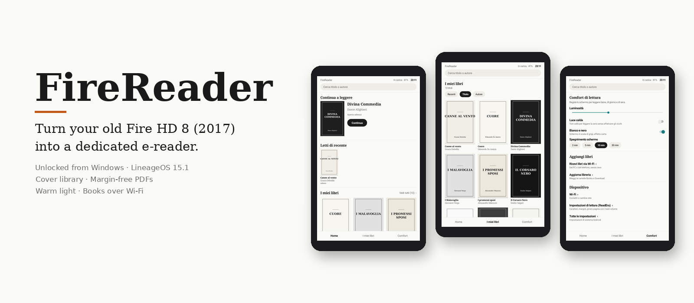
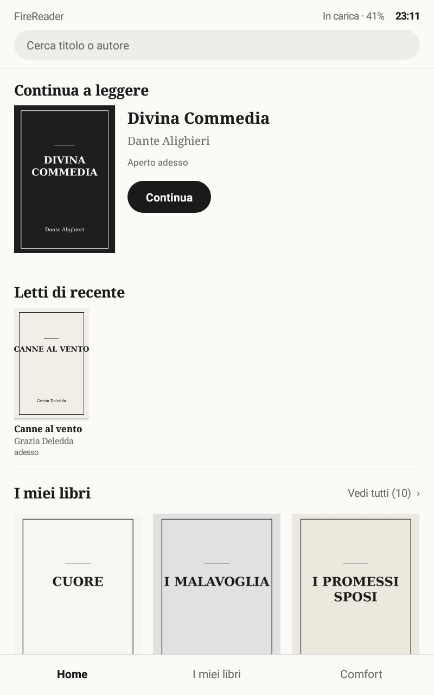
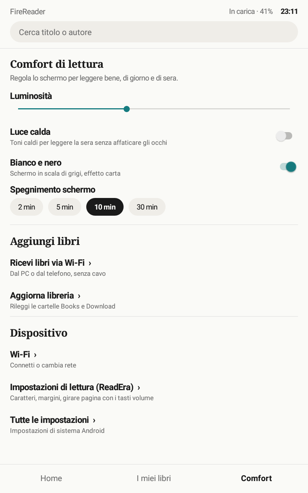
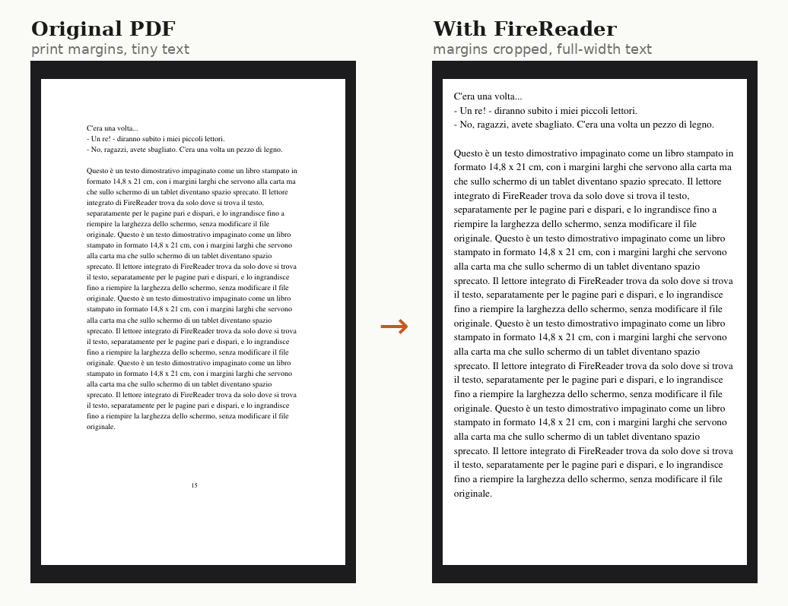
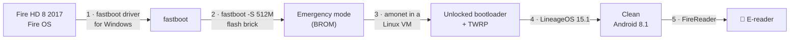

<div align="center">



# FireReader

**Your old Amazon Fire HD 8 (2017) is not dead. It's an e-reader waiting to happen.**

Unlock it entirely from **Windows**, replace Fire OS with LineageOS,
and get a home screen built for one thing only: reading.

[](LICENSE)
[](https://github.com/HokutoNoCode/FireReader/releases/latest)
[](app)
[-ff9900?style=flat-square)](docs/GUIDE.md)
[](https://github.com/HokutoNoCode/FireReader/releases/latest)
[](CONTRIBUTING.md)

[**Step-by-step guide**](docs/GUIDE.md) ·
[**How the code works**](docs/ARCHITECTURE.md) ·
[**Download the APK**](https://github.com/HokutoNoCode/FireReader/raw/main/release/FireReader-3.1.0.apk) ·
[**Contributing**](CONTRIBUTING.md) ·
[🇮🇹 Italiano](README.it.md)

</div>

---

## Contents

- [Why FireReader](#why-firereader)
- [Features](#features)
- [Screenshots](#screenshots)
- [How you get there](#how-you-get-there)
- [Quick start](#quick-start)
- [What's in the repository](#whats-in-the-repository)
- [FAQ](#faq)
- [Roadmap](#roadmap)
- [Contributing](#contributing)
- [Warnings](#warnings)
- [Credits](#credits)
- [License](#license)

## Why FireReader

Millions of Fire HD 8 tablets are sitting in drawers. Fire OS is slow, full of ads and no longer gets meaningful
updates. As a **book reader**, though, the hardware is still great: an 8" screen, a battery that lasts for days
of reading, and volume keys that make perfect page-turn buttons.

The catch: every unlock guide out there assumes **Linux**, and on Windows you get stuck at three specific points.
FireReader is the full procedure **tested end to end from Windows**, plus an app that turns the tablet into
something that feels like a Kobo or a Kindle, except it's yours and it's open.

## Features

| | |
|---|---|
| 📚 **Cover library** | Real covers extracted from PDF, EPUB and CBZ. Search by title or author, sort by recent, title or author |
| 📖 **Continue reading** | Your current book up front, with **real page and percentage**, plus a *recently read* row |
| ✂️ **Margin-free PDFs** | Built-in PDF reader that **automatically crops print margins** (odd and even pages handled separately) so text fills the full screen width. Your file is never modified |
| 🔊 **Page turns** | Tap left or right, swipe, or use the **volume keys** |
| 🌙 **Reading comfort** | Brightness, adjustable **warm light** for the evening, paper-like **grayscale**, screen timeout |
| 📶 **Books over Wi-Fi** | Open `http://<tablet-ip>:8080` on your PC or phone and drag files in. No cable, no app |
| 💡 **Smart screen** | Stays on while you read, turns itself off after 15 minutes without a page turn |
| 🪶 **Featherweight** | About 40 KB, plain Java, zero external libraries, no ads, no tracking, no calls to outside servers |

> [!NOTE]
> The app's interface is currently in **Italian**. An English translation is the top item on the
> [roadmap](#roadmap), and a great [first contribution](CONTRIBUTING.md#where-to-start).

## Screenshots

<div align="center">
&nbsp;
&nbsp;

<br><sub><b>Home</b> · <b>My books</b> · <b>Comfort</b> (demo library of public-domain classics)</sub>
<br><br>

<br><sub>The built-in PDF reader strips the margins meant for paper and uses the whole screen.</sub>
</div>

## How you get there



| Step | What breaks on Windows | The fix in this repo |
|:---:|---|---|
| 1 | In fastboot mode the Fire (`USB\VID_1949&PID_0260`) has no driver, so `fastboot` hangs on *waiting for any device* | A locally signed WinUSB driver package → [`windows/driver`](windows/driver) |
| 2 | Modern fastboot splits the exploit image into "sparse" chunks and the exploit never fires | `fastboot -S 512M flash brick …` |
| 3 | The `amonet` script reaches *"all good"* and then dies with `read fail`: the Windows serial stack can't talk to the payload | A tiny Ubuntu VM that grabs the tablet over USB by itself → [`vm`](vm) |

Every step, with the exact commands and what you should see on the screen, is in the
**[step-by-step guide](docs/GUIDE.md)**.

## Quick start

> Already running LineageOS on a Fire HD 8 2017 (or any Android 5.0+ tablet)? These commands are all you need.
> Starting from Fire OS? Follow the **[step-by-step guide](docs/GUIDE.md)** first.

```bash
# 1. download release/FireReader-3.1.0.apk (or build it: cd app && ./build.sh)
adb install FireReader-3.1.0.apk

# 2. grant permissions (brightness, warm light, grayscale, books)
adb shell pm grant it.firereader.home android.permission.READ_EXTERNAL_STORAGE
adb shell pm grant it.firereader.home android.permission.WRITE_EXTERNAL_STORAGE
adb shell pm grant it.firereader.home android.permission.WRITE_SECURE_SETTINGS
adb shell appops set it.firereader.home WRITE_SETTINGS allow
adb shell appops set it.firereader.home SYSTEM_ALERT_WINDOW allow

# 3. make it the tablet's home screen
adb shell cmd package set-home-activity it.firereader.home/.Home
```

Put your books in the **`Books`** folder of internal storage, or use **Comfort → Receive books over Wi-Fi**.
For EPUB and other formats, also install [ReadEra](https://readera.org) (free).

## What's in the repository

```text
FireReader/
├── app/                         The FireReader app (plain Java, no Gradle)
│   ├── AndroidManifest.xml      Permissions, home launcher, reader and warm-light service
│   ├── build.sh                 Builds and signs the APK using only the Android build-tools
│   └── src/it/firereader/home/
│       ├── Home.java            Home screen, library, search, Comfort, Wi-Fi server
│       ├── Reader.java          PDF reader with automatic margin cropping
│       └── Warm.java            Warm-light overlay on top of the screen
├── windows/
│   ├── driver/                  WinUSB fastboot driver for Fire tablets + (un)install scripts
│   └── adb-bridge.bat           Optional bridge to run Windows commands from a script
├── vm/                          Ubuntu VM for VirtualBox that grabs the tablet over USB
├── patches/                     Patch to run amonet without a keyboard
├── docs/
│   ├── GUIDE.md                 The full step-by-step procedure (🇮🇹 GUIDA.md)
│   └── ARCHITECTURE.md          How every file works, line by line where it matters (🇮🇹 ARCHITETTURA.md)
├── release/                     Prebuilt, signed APK + SHA-256 checksum
├── assets/ · screenshots/       README artwork
├── CONTRIBUTING.md              How to contribute
└── CHANGELOG.md                 Version history
```

Every file is explained in detail in **[docs/ARCHITECTURE.md](docs/ARCHITECTURE.md)**.

## FAQ

<details>
<summary><b>Does it work on other Fire tablets (HD 10, Fire 7, HD 8 2018/2020…)?</b></summary>

The **unlock** described here is for the **Fire HD 8 2017 "douglas" (KFDOWI)** only. Do not try it on other
models. The **FireReader app**, on the other hand, runs on any Android 5.0+ device: use it on another unlocked
tablet or on any ordinary Android tablet.
</details>

<details>
<summary><b>Can I use the Kindle app or books bought on Amazon/Kobo?</b></summary>

The newest ROM for this model is LineageOS 15.1 (Android 8.1), and current Kindle and Kobo apps require newer
Android versions. FireReader reads your own **DRM-free** files (EPUB, PDF, CBZ, MOBI…).
</details>

<details>
<summary><b>Why not Android 9 or later?</b></summary>

Android 9 and 10 ROMs exist for the Fire HD 8 **2018** ("karnak"), not the 2017 model. Development for
"douglas" stops at LineageOS 15.1.
</details>

<details>
<summary><b>The screen went completely black. Did I break it?</b></summary>

Almost certainly not. After the intentional "brick" the screen is **supposed** to stay black (see the guide).
On LineageOS, this ROM's lock screen is black and looks exactly like a powered-off tablet: the guide shows how
to turn it off.
</details>

<details>
<summary><b>Can margin cropping cut off part of a page?</b></summary>

No. The reader always merges the book's typical text box with the actual content of **each** page, so
headings, footnotes and wider images stay visible. If a book looks better uncropped, tap the center and choose
**Margins: original** (the setting is saved per book).
</details>

<details>
<summary><b>Do I really need Linux or a VM?</b></summary>

Only for one step (step 3, *bootrom*). Everything else happens on Windows. The VM is created by a script, and
you don't have to install Linux on your PC. Already on Linux? Skip the VM and run that step natively.
</details>

## Roadmap

- [ ] English interface (with Italian kept as a second language)
- [ ] Built-in EPUB reader (pagination, fonts, line spacing) so no external app is needed
- [ ] Collections / custom shelves
- [ ] [Calibre](https://calibre-ebook.com) sync (wireless device protocol)
- [ ] Offline dictionary and highlights
- [ ] Dedicated app icon

Got an idea? Open an [issue](https://github.com/HokutoNoCode/FireReader/issues/new/choose).

## Contributing

All help is welcome: code, testing on other devices, guide fixes, translations.
Read **[CONTRIBUTING.md](CONTRIBUTING.md)**: it covers building, testing on a tablet and submitting changes.

## Warnings

> [!WARNING]
> - The unlock is **only** for the **7th-generation Fire HD 8 (2017), "douglas", KFDOWI**.
> - Unlocking **wipes all data** on the tablet and voids the warranty. Proceed **at your own risk**.
> - The unlock files (preloader, TrustZone, LK, brick images, TWRP) and the ROMs are **not included**:
>   they belong to their authors and to Amazon. Download them from the original sources linked in the guide.

> [!IMPORTANT]
> The fastboot driver installs a **self-signed certificate** into Windows' trusted stores.
> Remove it when you're done with `windows/driver/uninstall-driver.ps1`.
> `windows/adb-bridge.bat` runs whatever is written into its command file: start it only when you need it.

## Credits

FireReader is the last piece of the puzzle. The hard work was done by others:

- **k4y0z**: *[UNLOCK][ROOT][TWRP][UNBRICK] Fire HD 8 2017 (douglas)* on XDA (amonet-douglas, brick-douglas, TWRP)
- **xyz\`**: the original *amonet* exploit for MediaTek bootroms
- **diplomatic**: *mtk-su*
- **Rortiz2**: LineageOS 12.1 / 14.1 / 15.1 for douglas
- **ryanfortner**: [procedure summary](https://github.com/ryanfortner/FireHD8-2017)
- **ReadEra**: the reader used for EPUB and other formats

Amazon, Fire, Kindle, Kobo, LineageOS and ReadEra are trademarks of their respective owners.
FireReader is not affiliated with any of them.

## License

The code in this repository is released under the **[MIT](LICENSE)** license.
The third-party tools mentioned keep their own licenses.
