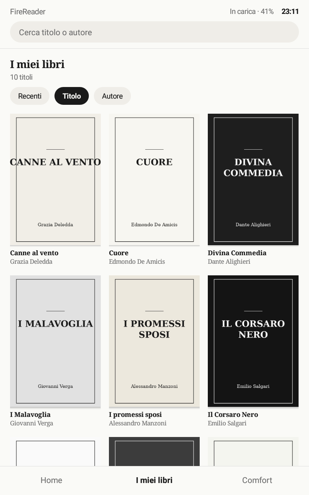

# FireReader

**Trasforma un vecchio Amazon Fire HD 8 (2017) in un e-reader dedicato.**
Sblocco dal **PC Windows**, LineageOS 15.1 al posto di Fire OS e una home pensata solo per leggere.

*[English summary below](#english)*

  
  
  

## Cosa c'è qui

| Cartella | Contenuto |
|---|---|
| [`app/`](app) | **FireReader**, la home da e-reader: codice Java, nessuna dipendenza, si compila con `build.sh` |
| [`windows/driver/`](windows/driver) | Driver **fastboot** WinUSB per i Fire (Windows non ne ha uno), con script di installazione e rimozione |
| [`vm/`](vm) | Macchina virtuale Ubuntu in VirtualBox che **aggancia il tablet via USB da sola**, per il passaggio di amonet che su Windows fallisce |
| [`patches/`](patches) | Piccola patch per far girare amonet senza tastiera (via SSH) |
| [`docs/GUIDA.md`](docs/GUIDA.md) | **Guida passo passo** completa, con i problemi incontrati e come risolverli |

## FireReader, la home

- Si accende direttamente sulla libreria, senza barre di Android
- **Continua a leggere** con la copertina grande e i letti di recente
- **Libreria a copertine** (PDF, EPUB, CBZ generate automaticamente), ricerca, ordinamento per recenti, titolo o autore
- **Comfort**: luminosità, **luce calda** regolabile per la sera, **bianco e nero**, timeout schermo
- **Ricevi libri via Wi-Fi**: dal PC o dal telefono apri `http://<ip-del-tablet>:8080` e trascini i file
- **Lettore PDF integrato con ritaglio automatico dei margini**: trova dove sta il testo (pagine pari e dispari separate) e lo porta a tutta larghezza, senza modificare il file; pagina con tocco o tasti volume, segnalibro e percentuale di lettura
- EPUB e altri formati si aprono con [ReadEra](https://readera.org) (o qualsiasi lettore installato)
- Android 5.0+, circa 40 KB

## Perché questo repo

Le guide esistenti per sbloccare il Fire HD 8 2017 sono pensate per Linux. Da Windows ci sono tre
ostacoli, qui risolti:

1. **Nessun driver fastboot** → pacchetto WinUSB firmato in locale ([`windows/driver`](windows/driver))
2. **Il fastboot moderno spezza l'immagine "brick"** → `fastboot -S 512M flash brick …`
3. **Il passaggio bootrom fallisce con `read fail`** → VM Linux con filtri USB automatici ([`vm`](vm))

## Avvertenze

- **Solo Fire HD 8 di 7ª generazione (2017), "douglas", KFDOWI.** Su altri modelli può danneggiare il dispositivo.
- Lo sblocco **cancella tutti i dati** e invalida la garanzia. Procedi a tuo rischio.
- I file di sblocco (preloader, TrustZone, LK, immagini brick, TWRP) e le ROM **non sono inclusi**:
  appartengono ai rispettivi autori e ad Amazon. Scaricali dalle fonti originali (sotto).
- Il driver installa un certificato autofirmato: **rimuovilo a fine lavoro** con `uninstall-driver.ps1`.
- `windows/adb-bridge.bat` esegue tutto ciò che viene scritto nel suo file di comandi: avvialo solo
  quando ti serve e chiudilo subito dopo.

## Crediti

FireReader è solo il pezzo finale: il lavoro difficile l'hanno fatto altri.

- **k4y0z**, *[UNLOCK][ROOT][TWRP][UNBRICK] Fire HD 8 2017 (douglas)*, XDA: amonet-douglas, brick-douglas, TWRP
- **xyz`**: exploit originale amonet per i bootrom MediaTek
- **diplomatic**: mtk-su
- **Rortiz2**: LineageOS 12.1 / 14.1 / 15.1 per douglas
- **ryanfortner**: [riassunto della procedura su GitHub](https://github.com/ryanfortner/FireHD8-2017)

Nomi e marchi citati (Amazon, Fire, Kindle, Kobo, LineageOS, ReadEra) appartengono ai rispettivi
proprietari. Questo progetto non è affiliato a nessuno di loro.

## Licenza

Il codice di questo repository è sotto licenza [MIT](LICENSE). Gli strumenti di terze parti citati
mantengono le loro licenze.

---

## English

**FireReader turns an old Amazon Fire HD 8 (2017, "douglas") into a dedicated e-reader**, starting from a
Windows PC. The repo contains:

- `app/`: a tiny, dependency-free Android home screen for reading (cover library, recently read,
  search and sort, warm light, grayscale, brightness, Wi-Fi book upload at `http://<tablet-ip>:8080`) with a
  built-in PDF reader that auto-crops print margins (odd/even pages separately) so text fills the screen width.
  Build it with `app/build.sh`.
- `windows/driver/`: a WinUSB **fastboot driver** for Fire tablets (`VID_1949&PID_0260`), signed locally
  with a throw-away certificate (use `uninstall-driver.ps1` afterwards).
- `vm/`: a headless Ubuntu VirtualBox VM with USB filters (0E8D/1949), needed because on Windows the
  amonet bootrom step fails with `read fail` right after the payload loads.
- `docs/GUIDA.md`: the full step-by-step guide (Italian). Key Windows tip: use
  `fastboot -S 512M flash brick brick-9820.img`, or modern fastboot will resparse the exploit image.

Third-party unlock files and ROMs are **not** included; get them from k4y0z's and Rortiz2's XDA threads.
Unlocking wipes the device; you do it at your own risk.
