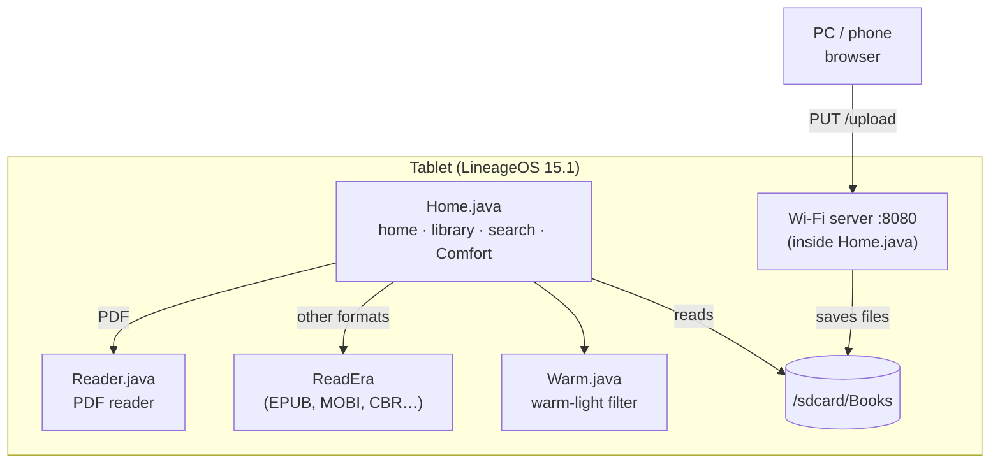

# How FireReader works: every file explained

🇮🇹 [Versione italiana](ARCHITETTURA.md)

This page is for anyone who wants to **understand, change or improve** the project. To unlock the tablet step
by step, see the [guide](GUIDE.md) instead.

- [Overview](#overview)
- [The app (`app/`)](#the-app-app)
  - [`AndroidManifest.xml`](#androidmanifestxml)
  - [`Home.java`: home screen and library](#homejava-home-screen-and-library)
  - [`Reader.java`: the PDF reader with margin cropping](#readerjava-the-pdf-reader-with-margin-cropping)
  - [`Warm.java`: warm light](#warmjava-warm-light)
  - [`build.sh`: building without Android Studio](#buildsh-building-without-android-studio)
  - [Stored data](#stored-data)
- [The fastboot driver (`windows/driver/`)](#the-fastboot-driver-windowsdriver)
- [The bridge (`windows/adb-bridge.bat`)](#the-bridge-windowsadb-bridgebat)
- [The virtual machine (`vm/`)](#the-virtual-machine-vm)
- [The amonet patch (`patches/`)](#the-amonet-patch-patches)

---

## Overview

The app is a **launcher**: Android shows it when you press Home, instead of the stock home screen.
It has no external dependencies (no AndroidX, no libraries): the whole UI is built in code, so the APK
weighs about 40 KB and runs even on Android 5.

## The app (`app/`)

### `AndroidManifest.xml`

| Entry | What it's for |
|---|---|
| `minSdkVersion 21` | Android 5.0, the minimum for `PdfRenderer` |
| `targetSdkVersion 23` | Lets the app open books in external apps with a plain file path (`file://`), no `FileProvider` needed |
| `READ/WRITE_EXTERNAL_STORAGE` | Read the `Books` folder and save books received over Wi-Fi |
| `INTERNET`, `ACCESS_WIFI_STATE` | The small book-receiving server and reading the tablet's IP address |
| `WRITE_SETTINGS` | Change brightness and screen timeout from the Comfort tab |
| `WRITE_SECURE_SETTINGS` | Toggle **grayscale** (the system "daltonizer" filter in monochrome mode) |
| `SYSTEM_ALERT_WINDOW` | Draw the orange **warm-light** veil on top of every app |
| Activity `.Home` with `HOME` + `DEFAULT` | This is what makes it a launcher |
| Activity `.Reader` | The PDF reader |
| Service `.Warm` | Keeps the warm-light filter running |

`WRITE_SECURE_SETTINGS` and `SYSTEM_ALERT_WINDOW` can't be requested with a runtime popup: they are granted
once via adb (`pm grant` and `appops set`), as shown in the README.

### `Home.java`: home screen and library

A single `Activity` that redraws everything with `build()` whenever you switch tabs or return home.

| Part | Methods | What it does |
|---|---|---|
| Layout | `build()`, `navBar()`, `searchBar()` | Top bar (name, battery, clock), search, scrolling content, bottom bar with *Home · My books · Comfort* |
| Home | `buildHome()`, `heroRow()` | "Continue reading" (the most recently opened book, with page and percentage), "Recently read", library preview |
| Library | `buildLibrary()`, `chip()`, `sorted()` | Cover grid sortable by *Recent*, *Title*, *Author* (choice is saved) |
| Search | `buildSearch()` | Filters by title, author and file name |
| Covers | `coverView()`, `loadCover()`, `placeholder()` | PDF: first page rendered with `PdfRenderer`. EPUB and CBZ: the image named *cover*, otherwise the first one. Covers are generated on a background thread and cached as PNG (`getCacheDir()`). Until one is ready, a typographic cover with the title is shown |
| Title and author | `titleAuthor()` | Parsed from the file name: `Author - Title.pdf`. Without a dash, the whole name becomes the title |
| Scanning | `scan()`, `walk()` | Looks for books in `Books` and `Download` (up to 4 levels of subfolders). Formats: pdf, epub, cbr, cbz, mobi, azw3, fb2, djvu, txt, doc, docx, rtf |
| Opening | `open()` | **PDFs** go to the built-in `Reader`. Other formats open in **ReadEra** if installed, otherwise in any compatible app. Long-pressing a PDF also offers "Open with ReadEra" |
| Comfort | `buildComfort()`, `toggleRow()`, `SB` | Brightness (`Settings.System`), warm light (starts or stops `Warm`), grayscale (`accessibility_display_daltonizer`), screen timeout |
| Books over Wi-Fi | `wifiReceive()`, `startServer()`, `handle()`, `PAGE` | See below |

#### The server for receiving books over Wi-Fi

When you tap *Receive books over Wi-Fi*, the app opens a `ServerSocket` on port **8080** and shows the address
(`http://<ip>:8080`). The server speaks a minimal, hand-written HTTP:

- `GET /` returns the `PAGE` page: a box to drop files into. The page's JavaScript sends **each file in a
  separate request** `PUT /upload?name=<name>`, with the file content as the body.
  That way the server never has to decode `multipart/form-data`: it reads `Content-Length` bytes and writes them to disk.
- The file name is sanitized (`[\\/:*?"<>|]` → `_`), so nothing can be written outside `Books`.
- The server runs **only while the dialog is open**: pressing *Done* shuts it down.

> Security note: while the dialog is open, anyone on the same Wi-Fi network can send files into the `Books`
> folder. There's no authentication: it's meant for your home network.

#### Why `TW` and `SB` are `static` classes

With JDK 21, `javac` emits an unnamed `MethodParameters` attribute for anonymous classes that capture
variables, and that crashes `d8` (the DEX compiler). That's why the code uses **lambdas** or `static`
classes holding an explicit reference to the Activity (`h`, `r`). See also [CONTRIBUTING](../CONTRIBUTING.md).

### `Reader.java`: the PDF reader with margin cropping

Book PDFs are laid out for paper: on an 8" screen the margins waste about **30%** of the width and the text
ends up tiny. The reader fixes that without touching the file.

**1. Finding the text on a page** (`scan()`).
The page is rendered small (160 px wide). For every row and column it counts the "dark" pixels
(luminance < 215). The first and last index with at least one dark pixel give the content box, in coordinates
normalized from 0 to 1.

**2. The book's typical box** (`loadBoxes()`).
On a background thread, **24 pages** spread across the book are analyzed (skipping the first 4: cover, title
page, colophon). Results are split between **even and odd pages**, because in printed books the inner and
outer margins mirror each other. For each group a robust box is computed with quantiles (20% for left and top,
80% for right and bottom), so one odd page can't distort it.
The result is stored in preferences (`box:<path>:<size>`): the second time, the book opens instantly.

**3. Drawing a page** (`draw()`).
- The **cover** (page 0) is never cropped.
- For every other page: the typical box (even or odd) is **merged** with that page's own content.
  So headings, footnotes, tables or wider images are never cut off.
- A small padding is added (2.5% on the sides, 2% top and bottom).
- The box is scaled to the **screen width**. If it would overflow the height by more than 4%, it falls back
  to "fit page".
- Rendering uses a `Matrix` (translate and scale) passed to `PdfRenderer.Page.render()`: only the useful area
  is drawn, at full resolution.

**4. Navigation and performance.**
- Tap the right third or press **Volume down**: next page. Left third or **Volume up**: previous.
  Horizontal swipe: forward or back. Tap the center: menu.
- The menu has a slider to jump to any page, a way back to the library, *Start*, and the
  **Margins: cropped / original** button (saved per book in `crop:<path>`).
- The neighboring pages (previous and next) are prepared ahead of time and kept in a small cache, so page
  turns are instant.
- Every page change saves `page:<path>`, which the home screen uses for *"Page 34 of 190 · 18%"*.
- `FLAG_KEEP_SCREEN_ON`: the screen stays on while you read. After **15 minutes** without a page turn the flag
  is cleared and the system timeout applies again.

### `Warm.java`: warm light

A `Service` that adds a full-screen `View` to the system window (`TYPE_APPLICATION_OVERLAY`), **transparent to
touches**, colored orange (`#FF8A1E`) with an opacity proportional to the slider (0–200 out of 255).
It's the same idea as "blue light filter" apps and works on any ROM, including those without Night Light.

### `build.sh`: building without Android Studio

No Gradle needed. The script:

1. downloads from `dl.google.com` (first run only, into `app/.sdk/`) **build-tools 34**, the **android-27
   platform** (`android.jar`) and the `core-lambda-stubs.jar` from build-tools 30 (needed for lambdas with a Java 8 target);
2. `aapt2 link`: creates the base APK from the manifest;
3. `javac -source 8 -target 8`: compiles the Java against `android.jar`;
4. `d8`: converts the classes into `classes.dex`;
5. adds the DEX to the APK, runs `zipalign`;
6. `apksigner`: signs with **your** key. On the first build `firereader.keystore` is created
   (default password `changeit`, override with `KEYSTORE_PASS`). The file is in `.gitignore`: **never publish it**.

Requirements: bash, curl, unzip, zip and JDK 11 or later (`javac`, `keytool`). On Windows it works from Git Bash or WSL.

### Stored data

Everything lives in the app's `SharedPreferences` (file `k`):

| Key | Content |
|---|---|
| `t:<path>` | Date and time of last opening (drives "Recent" and "Continue reading") |
| `page:<path>`, `pages:<path>` | Current page and page count (progress) |
| `crop:<path>` | Whether margin cropping is on for that book |
| `box:<path>:<size>` | Computed text boxes (even and odd pages) |
| `sort` | Library sort order |
| `warm`, `warmLevel` | Warm light on/off and intensity |

Covers live in `cache/` and are regenerated if the file size changes.

---

## The fastboot driver (`windows/driver/`)

### `fire_fastboot.inf`

Windows recognizes the Fire in normal (ADB) mode with the WinUSB driver that ships with the system, but **not in
fastboot**, where the tablet shows up as `USB\VID_1949&PID_0260` (Lab126) with no driver attached (error 28).

| Section | Explanation |
|---|---|
| `Class = USBDevice` | The standard class for WinUSB devices |
| `[FireDev.NTamd64]` | The USB IDs the driver applies to: the Fire HD 8 2017 fastboot (`1949:0260`) and other fastboot IDs seen on Fire tablets |
| `Include = winusb.inf` / `Needs = WINUSB.NT` | **No binary of ours**: it uses Microsoft's `winusb.sys`, already part of Windows |
| `DeviceInterfaceGUIDs = {F72FE0D4-…}` | The Android interface GUID. `fastboot.exe` (via `AdbWinUsbApi.dll`) looks for devices **only** with this GUID: without it the driver installs but fastboot still can't see the tablet |

### `install-driver.ps1`

64-bit Windows only installs **signed** driver packages. The script:

1. finds `makecat.exe` and `signtool.exe` from the Windows SDK;
2. creates the `fire_fastboot.cat` catalog (the INF's fingerprint);
3. creates a **self-signed code-signing certificate** (`CN=FireReader Driver`, valid for one year) and adds it
   to the machine's *Trusted Root Certification Authorities* and *Trusted Publishers*;
4. signs the catalog and installs the driver with `pnputil /add-driver … /install`.

### `uninstall-driver.ps1`

Removes the driver package (`pnputil /delete-driver`) and **deletes the certificate** from every store.
Run it when you're done: a self-signed root certificate left on your PC is a needless risk.

## The bridge (`windows/adb-bridge.bat`)

An **optional** tool, built to let an assistant or a script running in a sandbox (with no access to USB ports)
work on the Windows PC the tablet is plugged into.

- Every second it checks whether `bridge\cmd.txt` exists.
- If it does, it reads the line, deletes the file, writes the line into `job.bat`, runs it and saves the output
  to `bridge\out.txt`, then updates `done.txt` to signal completion.
- To chain several commands on one line, use `^&`, which becomes `&` when the bridge rewrites the command.

> ⚠️ It runs **anything** written into `cmd.txt`. Start it only when you need it and close it right after.

## The virtual machine (`vm/`)

On Windows, amonet's *bootrom* step stops with `read fail` right after loading the payload.
On Linux it works, so the fix is a minimal VM that **grabs the tablet over USB by itself**.

| File | What it does |
|---|---|
| `user-data.template` | *cloud-init* config: user `fire` with SSH-key-only login, packages `python3-serial`, `adb`, `fastboot`; installs `linux-modules-extra` (cloud images lack the `cdc_acm` module for the bootrom's serial port); disables ModemManager, which would otherwise "steal" the serial port |
| `make-seed.py` | Inserts your public SSH key into the template and builds `seed.iso` (label `CIDATA`, *NoCloud* format) with `pycdlib` |
| `create-vm.ps1` | Downloads the Ubuntu 24.04 cloud image (`.ova`), imports it into VirtualBox (2 GB RAM, **1 CPU**: with more CPUs and Hyper-V enabled the kernel may hang at boot), forwards SSH to `127.0.0.1:2222`, attaches `seed.iso`, enables USB 3 (xHCI) and creates **USB filters** for `0E8D` (MediaTek, bootrom) and `1949` (Lab126, fastboot and adb). Starts the VM headless |

The USB filters are the key part: during the unlock the tablet disconnects and reconnects several times with a
different identity, and the VM has to catch it on its own every time, within a fraction of a second.

## The amonet patch (`patches/`)

`amonet-noninteractive.patch` replaces, in `modules/load_payload.py`, the wait for the Enter key
(*"remove the short and press Enter"*) with a 4-second pause. It's needed when the script runs over SSH or from
another program, where there's no keyboard to press Enter on.
