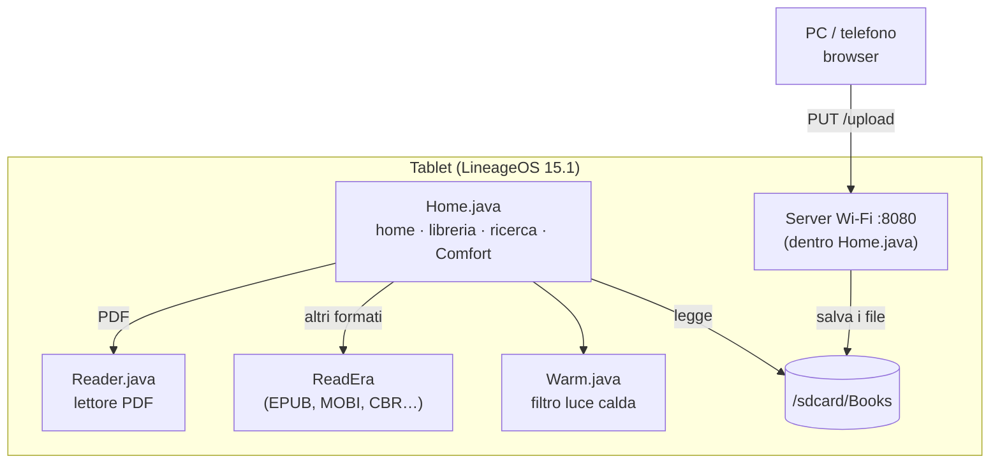

# Come funziona FireReader: ogni file spiegato

Questa pagina è per chi vuole **capire, modificare o migliorare** il progetto. Per sbloccare il tablet passo
passo vedi invece la [guida](GUIDA.md).

- [Panoramica](#panoramica)
- [L'app (`app/`)](#lapp-app)
  - [`AndroidManifest.xml`](#androidmanifestxml)
  - [`Home.java`: la home e la libreria](#homejava-la-home-e-la-libreria)
  - [`Reader.java`: il lettore PDF con ritaglio dei margini](#readerjava-il-lettore-pdf-con-ritaglio-dei-margini)
  - [`Warm.java`: la luce calda](#warmjava-la-luce-calda)
  - [`build.sh`: compilare senza Android Studio](#buildsh-compilare-senza-android-studio)
  - [Dati salvati](#dati-salvati)
- [Il driver fastboot (`windows/driver/`)](#il-driver-fastboot-windowsdriver)
- [Il ponte (`windows/adb-bridge.bat`)](#il-ponte-windowsadb-bridgebat)
- [La macchina virtuale (`vm/`)](#la-macchina-virtuale-vm)
- [La patch per amonet (`patches/`)](#la-patch-per-amonet-patches)

---

## Panoramica

L'app è un **launcher**: Android la mostra quando premi Home, al posto della schermata standard.
Non ha dipendenze esterne (né AndroidX né librerie): tutta l'interfaccia è costruita in codice,
così l'APK pesa circa 40 KB e gira anche su Android 5.

## L'app (`app/`)

### `AndroidManifest.xml`

| Voce | A cosa serve |
|---|---|
| `minSdkVersion 21` | Android 5.0, il minimo per `PdfRenderer` |
| `targetSdkVersion 23` | Permette di aprire i libri in app esterne con un semplice percorso di file (`file://`) senza `FileProvider` |
| `READ/WRITE_EXTERNAL_STORAGE` | Leggere la cartella `Books` e salvarci i libri ricevuti via Wi-Fi |
| `INTERNET`, `ACCESS_WIFI_STATE` | Il piccolo server per ricevere i libri e la lettura dell'indirizzo IP del tablet |
| `WRITE_SETTINGS` | Cambiare luminosità e tempo di spegnimento dalla scheda Comfort |
| `WRITE_SECURE_SETTINGS` | Attivare o disattivare il **bianco e nero** (filtro di sistema "daltonizzatore", modalità monocromia) |
| `SYSTEM_ALERT_WINDOW` | Disegnare il velo arancione della **luce calda** sopra tutte le app |
| Activity `.Home` con `HOME` + `DEFAULT` | È ciò che la rende un launcher |
| Activity `.Reader` | Il lettore PDF |
| Service `.Warm` | Tiene attivo il filtro luce calda |

`WRITE_SECURE_SETTINGS` e `SYSTEM_ALERT_WINDOW` non si possono chiedere all'utente con un popup: si concedono
una volta via adb (`pm grant` e `appops set`), come indicato nel README.

### `Home.java`: la home e la libreria

È una singola `Activity` che ridisegna tutto con `build()` ogni volta che cambi scheda o torni alla home.

| Parte | Metodi | Cosa fa |
|---|---|---|
| Struttura | `build()`, `navBar()`, `searchBar()` | Barra in alto (nome, batteria, ora), ricerca, contenuto scorrevole, barra in basso con *Home · I miei libri · Comfort* |
| Home | `buildHome()`, `heroRow()` | "Continua a leggere" (il libro aperto più di recente, con pagina e percentuale), "Letti di recente", anteprima della libreria |
| Libreria | `buildLibrary()`, `chip()`, `sorted()` | Griglia di copertine ordinabile per *Recenti*, *Titolo*, *Autore* (scelta salvata) |
| Ricerca | `buildSearch()` | Filtra per titolo, autore e nome del file |
| Copertine | `coverView()`, `loadCover()`, `placeholder()` | PDF: prima pagina disegnata con `PdfRenderer`. EPUB e CBZ: l'immagine che si chiama *cover*, altrimenti la prima. Le copertine vengono generate in un thread separato e salvate in cache come PNG (`getCacheDir()`). Finché non è pronta, si vede una copertina tipografica col titolo |
| Titolo e autore | `titleAuthor()` | Ricavati dal nome del file: `Autore - Titolo.pdf`. Senza trattino, tutto il nome diventa il titolo |
| Scansione | `scan()`, `walk()` | Cerca i libri in `Books` e `Download` (fino a 4 livelli di sottocartelle). Formati: pdf, epub, cbr, cbz, mobi, azw3, fb2, djvu, txt, doc, docx, rtf |
| Apertura | `open()` | I **PDF** vanno al lettore integrato `Reader`. Gli altri formati si aprono con **ReadEra** se c'è, altrimenti con qualunque app compatibile. Tenendo premuto su un PDF c'è anche "Apri con ReadEra" |
| Comfort | `buildComfort()`, `toggleRow()`, `SB` | Luminosità (`Settings.System`), luce calda (avvia o ferma `Warm`), bianco e nero (`accessibility_display_daltonizer`), timeout dello schermo |
| Libri via Wi-Fi | `wifiReceive()`, `startServer()`, `handle()`, `PAGE` | Vedi sotto |

#### Il server per ricevere libri via Wi-Fi

Quando tocchi *Ricevi libri via Wi-Fi*, l'app apre un `ServerSocket` sulla porta **8080** e mostra l'indirizzo
(`http://<ip>:8080`). Il server parla un HTTP minimo scritto a mano:

- `GET /` restituisce la pagina `PAGE`: un riquadro dove trascinare i file. Il JavaScript della pagina invia
  **ogni file con una richiesta separata** `PUT /upload?name=<nome>`, con il contenuto del file come corpo.
  Così il server non deve decodificare `multipart/form-data`: legge `Content-Length` byte e li scrive su disco.
- Il nome del file viene ripulito (`[\\/:*?"<>|]` → `_`), quindi non si può scrivere fuori da `Books`.
- Il server resta acceso **solo finché la finestra è aperta**: premendo *Fatto* viene chiuso.

> Nota di sicurezza: mentre la finestra è aperta, chiunque sia sulla stessa rete Wi-Fi può inviare file nella
> cartella `Books`. Non c'è autenticazione: è pensato per la rete di casa.

#### Perché `TW` e `SB` sono classi `static`

Con JDK 21, `javac` genera per le classi anonime che catturano variabili un attributo `MethodParameters`
senza nome che fa andare in crash `d8` (il compilatore DEX). Per questo nel codice si usano **lambda** oppure
classi `static` con un riferimento esplicito all'Activity (`h`, `r`). Vedi anche [CONTRIBUTING](../CONTRIBUTING.md).

### `Reader.java`: il lettore PDF con ritaglio dei margini

I PDF dei libri sono impaginati per la carta: su uno schermo da 8" i margini sprecano circa il **30%** della
larghezza e il testo diventa piccolo. Il lettore risolve il problema senza toccare il file.

**1. Trovare il testo in una pagina** (`scan()`).
La pagina viene disegnata piccola (160 px di larghezza). Per ogni riga e colonna si contano i pixel
"scuri" (luminanza < 215). Il primo e l'ultimo indice con almeno un pixel scuro danno il riquadro del
contenuto, in coordinate normalizzate da 0 a 1.

**2. Il riquadro tipico del libro** (`loadBoxes()`).
In un thread separato vengono analizzate **24 pagine** distribuite nel libro (saltando le prime 4: copertina,
frontespizio, colophon). I risultati sono divisi tra **pagine pari e dispari**, perché nei libri stampati i
margini interno ed esterno sono speculari. Per ciascun gruppo si prende un riquadro robusto con i quantili
(20% per sinistra e alto, 80% per destra e basso), così una pagina strana non lo deforma.
Il risultato viene salvato nelle preferenze (`box:<percorso>:<dimensione>`): la seconda volta il libro si apre
subito.

**3. Disegnare una pagina** (`draw()`).
- La **copertina** (pagina 0) non viene mai ritagliata.
- Per le altre pagine: riquadro tipico (pari o dispari) **unito** al contenuto reale della pagina stessa.
  Così titoli, note, tabelle o immagini più larghe non vengono mai tagliati.
- Si aggiunge un piccolo bordo (2,5% ai lati, 2% sopra e sotto).
- Il riquadro viene scalato alla **larghezza dello schermo**. Se in altezza sborderebbe di più del 4%, si passa
  ad "adatta alla pagina".
- Il rendering usa una `Matrix` (traslazione e scala) passata a `PdfRenderer.Page.render()`: viene disegnata solo
  l'area utile, a piena risoluzione.

**4. Navigazione e prestazioni.**
- Tocco nel terzo destro o **Volume giù**: pagina successiva. Terzo sinistro o **Volume su**: precedente.
  Scorrimento orizzontale: avanti o indietro. Tocco al centro: menu.
- Il menu ha una barra per saltare a una pagina, il ritorno alla libreria, *Inizio* e il pulsante
  **Margini: ritagliati / originali** (salvato per ogni libro in `crop:<percorso>`).
- Le pagine vicine (precedente e successiva) vengono preparate in anticipo e tenute in una piccola cache, così
  girare pagina è immediato.
- Ogni cambio di pagina salva `page:<percorso>`, che la home usa per *"Pagina 34 di 190 · 18%"*.
- `FLAG_KEEP_SCREEN_ON`: lo schermo non si spegne mentre leggi. Dopo **15 minuti** senza girare pagina il flag
  viene tolto e torna a valere il timeout di sistema.

### `Warm.java`: la luce calda

Un `Service` che aggiunge alla finestra di sistema (`TYPE_APPLICATION_OVERLAY`) una `View` grande quanto lo schermo,
**trasparente al tocco**, colorata di arancione (`#FF8A1E`) con un'opacità proporzionale al cursore (0–200 su 255).
È lo stesso principio delle app "filtro luce blu" e funziona su qualsiasi ROM, anche quelle senza Night Light.

### `build.sh`: compilare senza Android Studio

Non serve Gradle. Lo script:

1. scarica da `dl.google.com` (solo la prima volta, in `app/.sdk/`) i **build-tools 34**, la **piattaforma
   android-27** (`android.jar`) e i `core-lambda-stubs.jar` dei build-tools 30 (servono per le lambda con target Java 8);
2. `aapt2 link`: crea l'APK base dal manifest;
3. `javac -source 8 -target 8`: compila il Java contro `android.jar`;
4. `d8`: converte le classi in `classes.dex`;
5. aggiunge il DEX all'APK, `zipalign`;
6. `apksigner`: firma con la **tua** chiave. Al primo build viene creata `firereader.keystore`
   (password di default `changeit`, cambiala con `KEYSTORE_PASS`). Il file è in `.gitignore`: **non va mai pubblicato**.

Requisiti: bash, curl, unzip, zip e un JDK 11 o superiore (`javac`, `keytool`). Su Windows funziona da Git Bash o WSL.

### Dati salvati

Tutto sta nelle `SharedPreferences` dell'app (file `k`):

| Chiave | Contenuto |
|---|---|
| `t:<percorso>` | Data e ora dell'ultima apertura (ordina "Recenti" e "Continua a leggere") |
| `page:<percorso>`, `pages:<percorso>` | Pagina corrente e numero di pagine (avanzamento) |
| `crop:<percorso>` | Ritaglio dei margini attivo o no per quel libro |
| `box:<percorso>:<dimensione>` | Riquadri del testo calcolati (pagine pari e dispari) |
| `sort` | Ordinamento scelto nella libreria |
| `warm`, `warmLevel` | Luce calda attiva e intensità |

Le copertine sono in `cache/` e vengono rigenerate se il file cambia dimensione.

---

## Il driver fastboot (`windows/driver/`)

### `fire_fastboot.inf`

Windows riconosce il Fire in modalità normale (ADB) con il driver WinUSB incluso nel sistema, ma **non in fastboot**,
dove il tablet si presenta come `USB\VID_1949&PID_0260` (Lab126) senza un driver associato (errore 28).

| Sezione | Spiegazione |
|---|---|
| `Class = USBDevice` | Categoria standard dei dispositivi WinUSB |
| `[FireDev.NTamd64]` | Elenco degli ID USB a cui applicare il driver: il fastboot del Fire HD 8 2017 (`1949:0260`) e altri ID fastboot visti sui Fire |
| `Include = winusb.inf` / `Needs = WINUSB.NT` | **Nessun file binario nostro**: si usa il `winusb.sys` di Microsoft già presente in Windows |
| `DeviceInterfaceGUIDs = {F72FE0D4-…}` | Il GUID dell'interfaccia Android. `fastboot.exe` (tramite `AdbWinUsbApi.dll`) cerca i dispositivi **solo** con questo GUID: senza, il driver si installa ma fastboot continua a non vedere il tablet |

### `install-driver.ps1`

Windows a 64 bit installa solo pacchetti driver **firmati**. Lo script:

1. trova `makecat.exe` e `signtool.exe` del Windows SDK;
2. crea il catalogo `fire_fastboot.cat` (l'impronta dell'INF);
3. crea un **certificato di firma autofirmato** (`CN=FireReader Driver`, valido un anno) e lo aggiunge a
   *Autorità di certificazione radice attendibili* e *Autori attendibili* del computer;
4. firma il catalogo e installa il driver con `pnputil /add-driver … /install`.

### `uninstall-driver.ps1`

Rimuove il pacchetto driver (`pnputil /delete-driver`) e **cancella il certificato** da tutti gli archivi.
Va eseguito a fine lavoro: un certificato radice autofirmato lasciato sul PC è un rischio inutile.

## Il ponte (`windows/adb-bridge.bat`)

Uno strumento **facoltativo**, nato per far lavorare un assistente o uno script che gira in un ambiente isolato
(senza accesso alle porte USB) sul PC Windows a cui è collegato il tablet.

- Ogni secondo controlla se esiste `bridge\cmd.txt`.
- Se c'è, legge la riga, la cancella, la scrive in `job.bat`, la esegue e salva l'output in `bridge\out.txt`,
  poi aggiorna `done.txt` per segnalare la fine.
- Per mettere più comandi in una riga si usa `^&`, che diventa `&` quando il ponte riscrive il comando.

> ⚠️ Esegue **qualsiasi** cosa venga scritta in `cmd.txt`. Avvialo solo quando serve e chiudilo subito dopo.

## La macchina virtuale (`vm/`)

Il passaggio *bootrom* di amonet su Windows si ferma con `read fail` subito dopo il caricamento del payload.
Su Linux funziona: la soluzione è una VM minima che **si prende il tablet via USB da sola**.

| File | Cosa fa |
|---|---|
| `user-data.template` | Configurazione *cloud-init*: utente `fire` con accesso solo via chiave SSH, pacchetti `python3-serial`, `adb`, `fastboot`; installa `linux-modules-extra` (le immagini cloud non hanno il modulo `cdc_acm` per la porta seriale del bootrom); disattiva ModemManager, che altrimenti "ruba" la porta seriale |
| `make-seed.py` | Inserisce la tua chiave SSH pubblica nel template e crea `seed.iso` (etichetta `CIDATA`, formato *NoCloud*) con `pycdlib` |
| `create-vm.ps1` | Scarica l'immagine cloud di Ubuntu 24.04 (`.ova`), la importa in VirtualBox (2 GB di RAM, **1 CPU**: con più CPU e Hyper-V attivo il kernel può bloccarsi all'avvio), inoltra la porta SSH su `127.0.0.1:2222`, collega `seed.iso`, attiva USB 3 (xHCI) e crea i **filtri USB** per `0E8D` (MediaTek, bootrom) e `1949` (Lab126, fastboot e adb). Avvia la VM senza finestra |

I filtri USB sono la parte importante: durante lo sblocco il tablet si scollega e si ricollega più volte cambiando
identità, e la VM deve agganciarlo ogni volta da sola, in una frazione di secondo.

## La patch per amonet (`patches/`)

`amonet-noninteractive.patch` sostituisce, in `modules/load_payload.py`, l'attesa del tasto Invio
(*"remove the short and press Enter"*) con una pausa di 4 secondi. Serve quando lo script gira via SSH o da
un altro programma, dove non c'è una tastiera da cui premere Invio.
